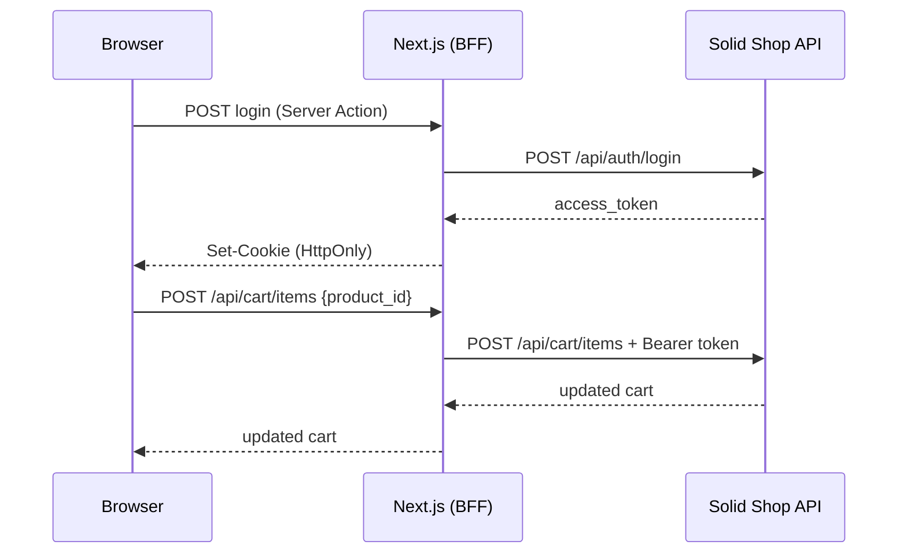

# Solid Shop Web

[](https://github.com/mhxtecnologia/solid-shop-web/actions/workflows/ci.yml)

Storefront for the [Solid Shop API](https://github.com/mhxtecnologia/solid-shop-api), built with
**Next.js 15 (App Router), React 19, TypeScript, Redux Toolkit and Tailwind CSS**.

## Highlights

- **Server Components** render the catalog and product pages; the browser only downloads
  JavaScript for the interactive parts (cart, add-to-cart button, login form).
- **BFF with HttpOnly session cookie**: login is a Server Action that stores the API's JWT in
  an `HttpOnly`, `SameSite=Lax` cookie. Client code calls `/api/cart/*` route handlers, which
  attach the token server-side, so the token is never readable by JavaScript (XSS-safe).
- **Input validated at the edge** (Zod) before being forwarded; numeric ids only in API paths.
- **One request per cart action**: the API returns the updated cart on add/remove.
- **Request deduplication** with React `cache()` for metadata + page data.
- **Graceful auth states**: a `401` is "not signed in", not an error — the cart hides and the
  header offers "Entrar"; an expired token clears the cookie.



## Running

Start the API first (`docker compose up` in
[solid-shop-api](https://github.com/mhxtecnologia/solid-shop-api)), then:

```bash
cp .env.example .env.local
npm install
npm run dev
```

Open `http://localhost:3000` and sign in with `demo@solidshop.dev` / `demo12345`.

## Tests

```bash
npm test
```

Vitest + Testing Library: cart slice (BFF routes, 401 handling, single round trip),
formatting helpers and the product grid.

## License

MIT
